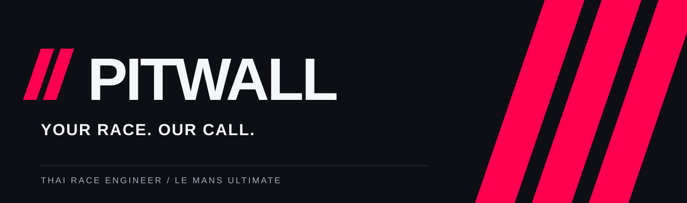

<strong>โฟกัสที่การขับ ที่เหลือให้เสียงจาก PITWALL ช่วยดูแล</strong>

วิศวกรการแข่งขันและ Spotter ภาษาไทย สำหรับ Le Mans Ultimate

  
  

---

### เสียงจากพิท ในภาษาของคุณ

PITWALL อ่านข้อมูลจากสนามและสื่อสารเป็นภาษาไทย ตั้งแต่รถที่กำลังเข้ามาข้างตัว ไปจนถึงเวลา น้ำมัน และสภาพรถ พร้อมเสียง Radio และตัวเลือกเรียกชื่อผู้ขับ

| ระหว่างแข่ง | PITWALL ช่วยอะไรได้บ้าง |
| :-- | :-- |
| **Spotter** | แจ้งรถซ้าย–ขวา รถประกบ และจังหวะที่พ้นแล้ว |
| **Race engineer** | รายงานเวลา เพซ อันดับ คู่แข่ง ธง และโทษปรับ |
| **Strategy** | ประเมินน้ำมัน Virtual Energy และข้อมูลเข้าพิทจาก telemetry ที่เกมส่งให้ |
| **Car health** | ติดตามยาง เบรก อุณหภูมิ ความเสียหาย ล้อล็อกและล้อฟรี |
| **Your voice** | ชุดเสียงภาษาไทย โหมด Radio / เสียงใส และชื่อเล่นที่เลือกได้ |
| **Updates** | ตรวจอัปเดตในแอป ดาวน์โหลดแยกจากชุดเสียง และติดตั้งเมื่อกดยืนยัน |

> รุ่นเปิดให้ทดลองใช้งาน ฟีเจอร์บางส่วนขึ้นกับข้อมูลและการตั้งค่าของเกม โดยเฉพาะ Formation / Safety Car ยังต้องทดสอบเพิ่มในสถานการณ์แข่งขันจริง

### เริ่มใช้งาน

1. ดาวน์โหลด **PITWALL-Setup-…-x64.exe** จาก [Latest release](https://github.com/xerenon/PITWALL/releases/latest) แล้วติดตั้ง
2. เปิด PITWALL แอปจะดาวน์โหลดและเตรียมชุดเสียงภาษาไทยให้อัตโนมัติ การดาวน์โหลดครั้งแรกต้องใช้อินเทอร์เน็ต
3. เมื่อเสร็จ แอปจะเปิดใหม่ให้พร้อมใช้งาน จากนั้นเลือกชื่อผู้ขับและรูปแบบเสียงที่ต้องการ
4. เปิด LMU ที่ตั้งค่าการส่ง telemetry สำหรับ PITWALL แล้ว เข้าไปอยู่ในรถบนสนาม จากนั้นกด **เริ่มทำงาน**

เมื่ออยู่หน้าเมนูเกม แอปอาจยังแสดง “กำลังรอเกม” การเชื่อมต่อจะเริ่มเมื่อเกมส่งข้อมูลสนามออกมา

**ระบบที่รองรับ:** Windows x64 และ Le Mans Ultimate ไม่ต้องติดตั้ง Node.js เพิ่ม ส่วน iRacing, Assetto Corsa Competizione และ Assetto Corsa ยังเป็น **Coming Soon**

### อัปเดตได้ โดยไม่เริ่มต้นใหม่

- แอปแจ้งเมื่อพบเวอร์ชันใหม่ หรือกดตรวจสอบเองในหน้าตั้งค่าได้
- ดาวน์โหลดและกด **ติดตั้งและเปิดใหม่** เมื่อพร้อม กรุณาหยุดวิศวกรและปิด LMU ก่อนติดตั้ง
- ระบบไม่ติดตั้งอัตโนมัติเพียงเพราะปิดแอป
- การตั้งค่า ชื่อผู้ขับ และชุดเสียงเก็บแยกจากตัวโปรแกรม
- ชุดเสียงแบ่งเป็นแพ็กย่อย ไฟล์เดิมที่ตรวจสอบผ่านจะถูกนำกลับมาใช้ เมื่อดาวน์โหลดสะดุดสามารถลองใหม่ได้
- รุ่น 0.11.2 ขึ้นไปดาวน์โหลดชุดเสียงผ่าน Cloudflare R2 พร้อม GitHub เป็นแหล่งสำรองเมื่อแหล่งหลักขัดข้อง
- ตัวอัปเดตตรวจลายเซ็นข้อมูลรีลีสและความถูกต้องของไฟล์ก่อนนำไปใช้

**สำหรับผู้ใช้ portable รุ่นเดิม:** ติดตั้งด้วย Setup หนึ่งครั้งเพื่อเปิดใช้งาน auto update

### แจ้งปัญหา

เปิด [Issue](https://github.com/xerenon/PITWALL/issues/new) พร้อมเวอร์ชันแอป รถ สนาม และเหตุการณ์ก่อนพบปัญหา ถ้าเป็นเรื่องเสียง กรุณาระบุข้อความที่ได้ยินและเวลาที่เกิดเหตุ

อย่าแนบ API key, รหัสผ่าน หรือข้อมูลส่วนตัวที่ไม่เกี่ยวข้อง

### สนับสนุน PITWALL

ร่วมสนับสนุนการพัฒนาได้ที่หน้า **Donate** ภายในแอป ขอบคุณที่เป็นส่วนหนึ่งของรอบต่อไป

---

Made with ❤️ by <a href="https://www.facebook.com/Surakat258">Aek</a>

Repository นี้ใช้สำหรับข้อมูลผลิตภัณฑ์ รายงานปัญหา และไฟล์ติดตั้ง ไม่ได้เผยแพร่ source code ของแอป

